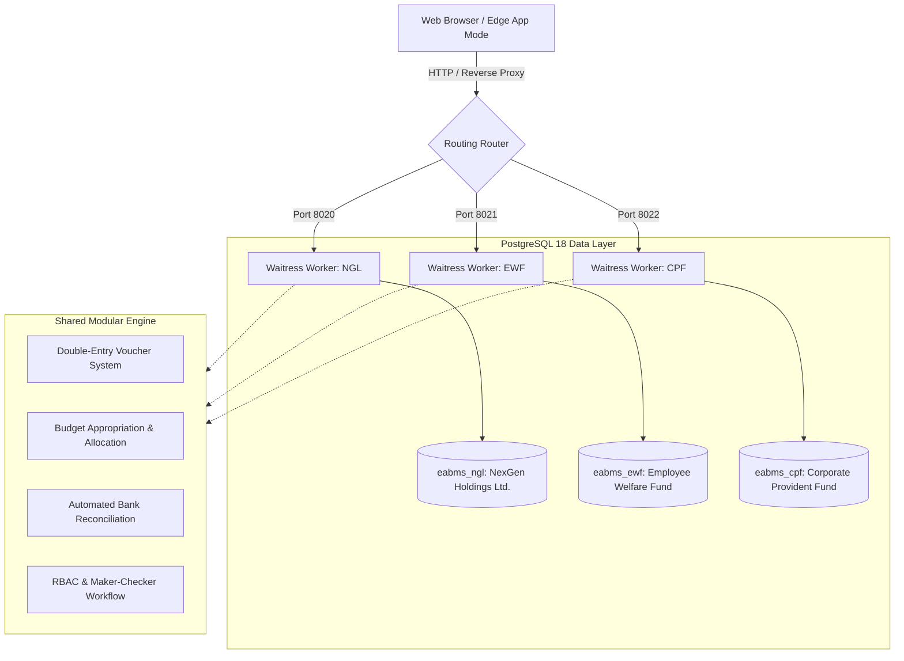

# Enterprise Accounts & Business Management System (EABMS)

[](https://www.python.org/)
[](https://www.djangoproject.com/)
[](https://www.postgresql.org/)
[](https://tailwindcss.com/)
[](https://docs.pylonsproject.org/projects/waitress/)
[](#security--role-based-access-control-rbac)
[](#testing--verification)

> **Enterprise Financial ERP & Multi-Entity Accounting Suite**  
> Designed for multi-tenant organizational accounting, strict budgetary governance, maker-checker transaction authorization, bank reconciliation, and automated financial intelligence reporting.

---

## 🌟 Executive Overview

**EABMS** (**Enterprise Accounts & Business Management System**) is an enterprise-grade accounting and financial governance system developed to replace error-prone spreadsheets and fragmented legacy tools. Engineered with a **multi-entity architecture**, it concurrently supports independent corporate accounts while maintaining strict fund separation, database isolation, and distinct operational ports.

### Key Highlights
- **Multi-Fund Database Isolation**: Concurrently operates 3 distinct corporate entities (`NGL`, `EWF`, `CPF`) on independent ports with dedicated PostgreSQL schemas.
- **Double-Entry Financial Governance**: Complete voucher lifecycle (`Draft` &rarr; `Submitted` &rarr; `Verified` &rarr; `Approved` &rarr; `Posted`) with immutable audit trails.
- **Automated Budget Controls**: Enforces expenditure ceilings with hard stops and executive approval overrides based on financial year appropriations.
- **Bank & Cash Reconciliation**: Comprehensive bank statement reconciliation module matching internal ledgers against bank records with variance analysis.
- **Production Windows Service Engine**: Self-contained, zero-downtime background execution with Waitress WSGI and Microsoft Edge App-Mode integration.

---

## 🏛 System Architecture & Multi-Entity Model

The application isolates organizational accounting into dedicated operational instances, each mapped to its own WSGI worker and PostgreSQL database.



### Entity Matrix

| Account Code | Legal Entity Name | Primary Purpose | Port | Database |
| :--- | :--- | :--- | :--- | :--- |
| **NGL** | **NexGen Holdings Ltd.** | Primary corporate operating account & revenue | `8020` | `eabms_ngl` |
| **EWF** | **Employee Welfare Fund** | Staff medical, welfare, education & recreation | `8021` | `eabms_ewf` |
| **CPF** | **Corporate Provident Fund** | Retirement funds, member deposits & yields | `8022` | `eabms_cpf` |

---

## 💼 Core Business Capabilities

### 1. General Ledger & Voucher Processing
- **Maker-Checker Workflow**: Segregation of duties prevents fraud. Clerks create and submit vouchers; authorized officers review and approve.
- **Head of Accounts (Chart of Accounts)**: Multi-tiered classification covering Inflow, Outflow, and Dual-nature Heads.
- **Opening Balances**: Financial-year level verified opening balances with automatic ledger continuity.

### 2. Budgetary Controls & Allocation
- **Dynamic Allocation Basis**: Supports both Account Head allocations (Operating Accounts) and Sub-Fund allocations (Special Purpose Funds).
- **Overspend Protection**: Real-time validation checks remaining budget balances prior to voucher authorization.
- **Multi-Year Budget Forecasting**: Tools for drafting, revising, and approving future fiscal year appropriations.

### 3. Bank & Cash Reconciliation
- **Reconciliation Engine**: Direct comparison of general ledger entries against bank statements.
- **Discrepancy Reporting**: Identifies unpresented cheques, uncleared deposits, and bank charges automatically.

### 4. Executive Reporting & Document Export
- Comprehensive balance sheets, trial balances, receipts & payments statements, and ledger summaries.
- One-click export to **Microsoft Word (`.docx`)**, **Microsoft Excel (`.xlsx`)**, and **PDF** via ReportLab and OpenPyXL.

---

## 🔐 Security & Role-Based Access Control (RBAC)

The system enforces strict permission boundaries across user tiers:

| Role | Permissions & Responsibilities |
| :--- | :--- |
| **Administrator (`admin`)** | Full system configuration, user provisioning, master data management, and audit log inspection. |
| **Accounts Clerk (`clerk`)** | Data entry, voucher drafting, sub-fund records, and basic report viewing. |
| **Senior Management (`management`)** | High-level approvals, budget authorization, final financial statements, and executive dashboards. |

---

## 🚀 Quick Start Guide

### Prerequisites
- **Python**: 3.12 or 3.13
- **PostgreSQL**: 15+ (PostgreSQL 18 recommended)
- **OS**: Windows 10/11 / Windows Server (or Linux with WSGI/Gunicorn)

### 1. One-Click Launch (Windows)
To start all three corporate instances in background mode:
- Run **`Start-All.bat`** (or individual scripts: `Start-NGL.bat`, `Start-EWF.bat`, `Start-CPF.bat`).
- Access the web interface:
  - **NGL**: [http://127.0.0.1:8020/](http://127.0.0.1:8020/)
  - **EWF**: [http://127.0.0.1:8021/](http://127.0.0.1:8021/)
  - **CPF**: [http://127.0.0.1:8022/](http://127.0.0.1:8022/)
- To gracefully stop all instances: Run **`Stop-All.bat`**.

### 2. Manual Development Setup

```powershell
# 1. Navigate to backend directory
cd 02_Backend

# 2. Create and activate virtual environment
python -m venv venv
.\venv\Scripts\Activate.ps1

# 3. Install dependencies
pip install -r requirements.txt

# 4. Configure environment variables
copy .env.example .env
# Edit .env with your PostgreSQL credentials

# 5. Run database migrations
python manage.py migrate

# 6. Seed corporate master data & initial accounts
python manage.py seed_eabms_corporate

# 7. Start the development server for NGL
$env:ABMS_FUND = "NGL"
python manage.py runserver 8020
```

### 3. Demo Credentials

| Username | Password | Role |
| :--- | :--- | :--- |
| `admin` | `admin123` | Administrator |
| `clerk` | `clerk123` | Accounts Clerk |
| `management` | `management123` | Senior Management |

---

## 🧪 Testing & Verification

The suite includes comprehensive automated tests covering multi-fund isolation, budget allocation mathematics, voucher workflows, and transaction validations.

```powershell
cd 02_Backend
pytest
```

---

## 📂 Project Organization

```text
EABMS/
├── 02_Backend/                     # Django ERP Core Application
│   ├── abms_config/                # Global settings, routing & WSGI configuration
│   ├── accounts/                   # Voucher entry, double-entry ledgers & transactions
│   ├── core/                       # Core master data, audit models & middleware
│   ├── masters/                    # Master configuration (Heads, Units, Financial Years)
│   ├── reports/                    # Financial reporting, balance sheets & exports
│   ├── templates/                  # Responsive Tailwind CSS interfaces
│   ├── static/                     # CSS, JavaScript & theme assets
│   ├── tests/                      # Automated test suite (Pytest & Django TestCase)
│   ├── manage.py                   # Django CLI management entrypoint
│   └── requirements.txt            # Production dependencies
├── DEPLOYMENT/
│   └── Windows/
│       └── Start-EABMS.ps1         # Robust multi-instance PowerShell launcher
├── Start-All.bat                   # Master launch script for all corporate accounts
├── Stop-All.bat                    # Master shutdown script
├── EABMS-NGL.vbs                   # Background silent launcher for NexGen Holdings
├── EABMS-EWF.vbs                   # Background silent launcher for Welfare Fund
├── EABMS-CPF.vbs                   # Background silent launcher for Provident Fund
└── README.md                       # Documentation & Portfolio Showcase
```

---

## 🛡 Security & Compliance Standards
- **Zero Hardcoded Secrets**: Strictly decouples configuration and environment variables via `.env`.
- **Protection Measures**: Built-in protection against SQL Injection (Django ORM parameterization), Cross-Site Scripting (XSS), and Cross-Site Request Forgery (CSRF).
- **Audit Trails**: Full logging of critical monetary adjustments, transaction edits, and state transitions.

---

## 👨‍💻 Developer & Author

- **GitHub**: [@Rizkayani19](https://github.com/Rizkayani19)
- **Specialization**: Enterprise Python / Django Full-Stack Systems, Financial ERPs, Database Architecture & High-Compliance Business Applications.
